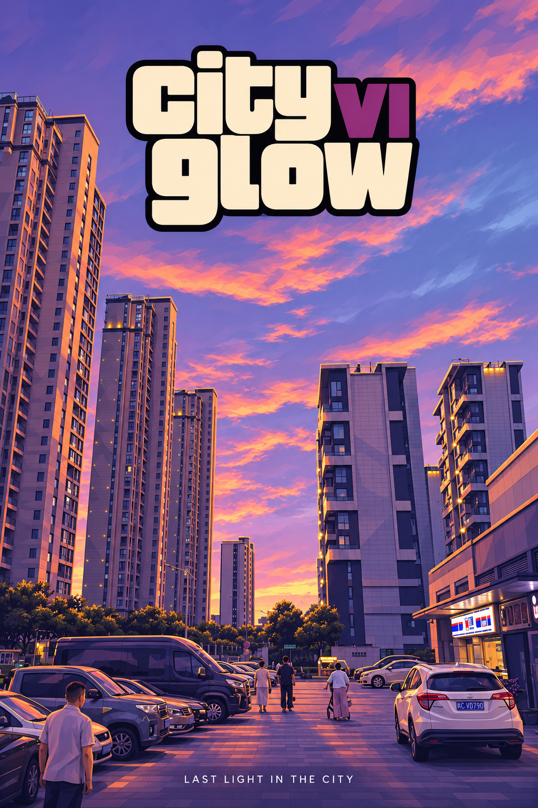
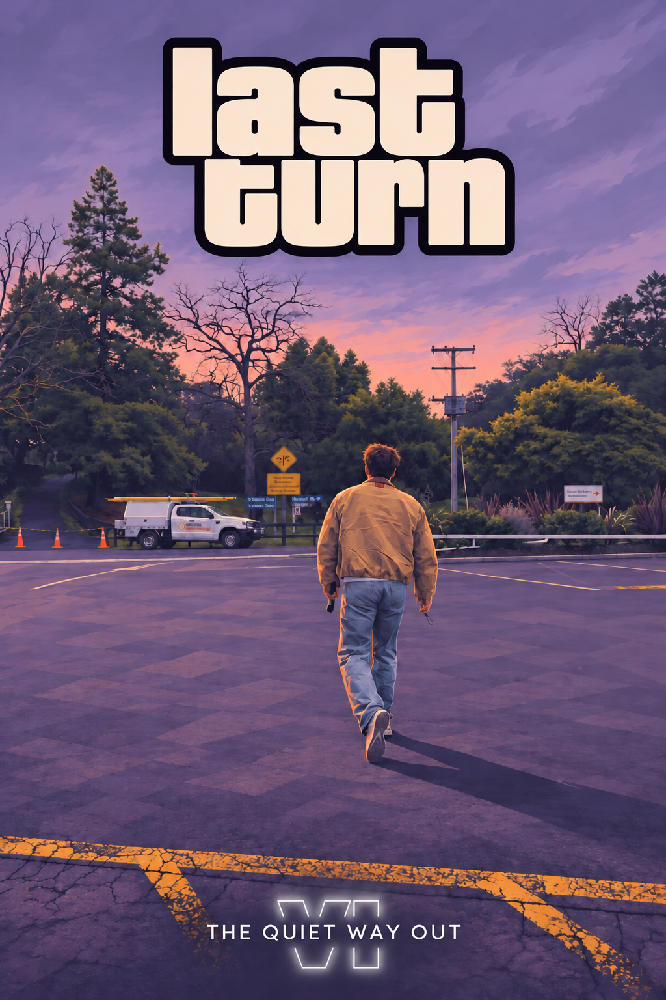

# GTA-style

把日常照片转成 GTA VI 灵感的插画海报。Skill 会先读照片，再拟标题、选 VI 的排法、生成并检查成图。适合人像、双人合照和街景。

## 在 Codex 里用

将仓库克隆到 Codex 的个人技能目录，文件夹命名为 `gta-style`。如果新技能还未显示，重新打开 Codex。

```sh
git clone https://github.com/Nealsun1993/GTA-style.git ~/.codex/skills/gta-style
```

附上照片后，可以说「用 $gta-style 把这张照片做成海报」。可以指定标题、小字、VI 版式，或附上你喜欢的视觉参考。直接出图需要当前环境提供图像生成工具。

这是独立制作的风格工作流。仓库包含文字规则，运行时由使用者提供照片和可选参考图。

## 成图示例

| City Glow · 标题嵌入 VI | Last Turn · 底部白光镂空 VI |
| --- | --- |
|  |  |
